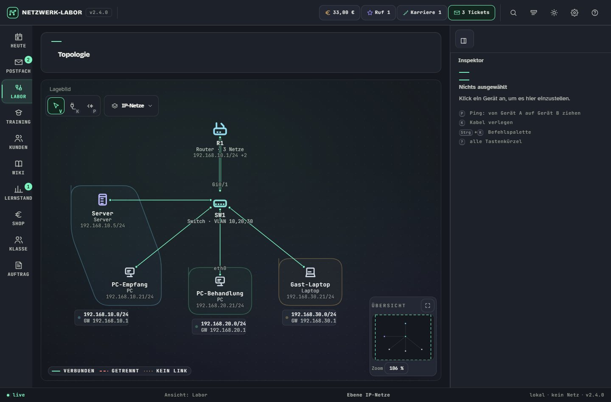
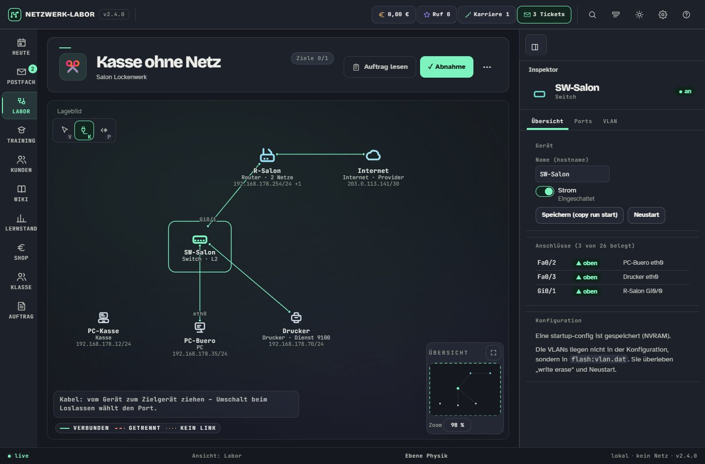
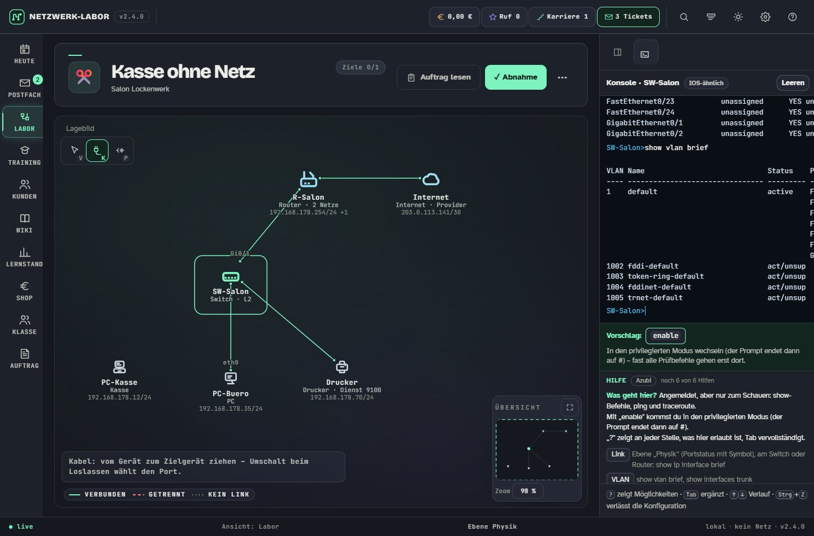
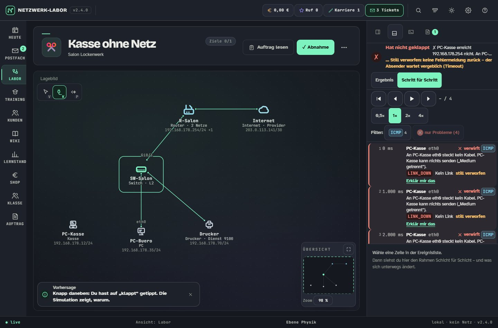
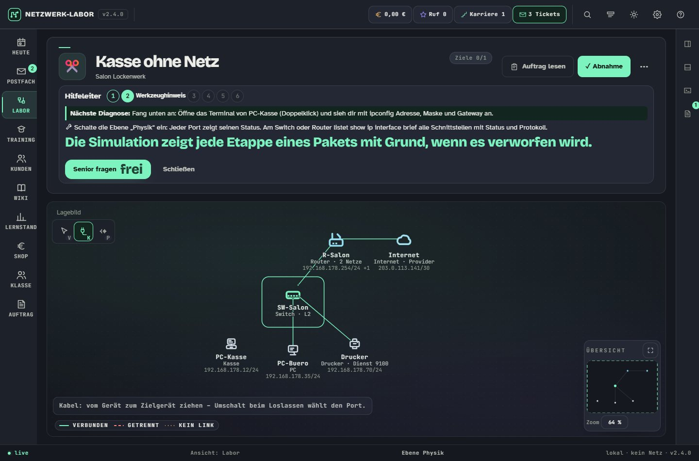
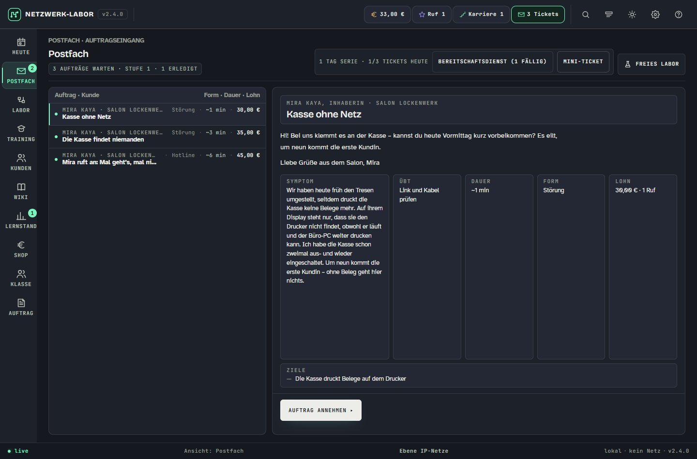
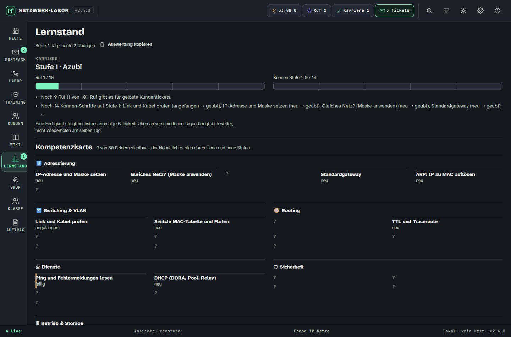

# Netzwerk-Labor

**Ein Netzwerk-Simulator zum Spielen: Du bist das Ein-Mann-Systemhaus.**
Kunden schicken Tickets („Die Kasse druckt nicht mehr"), du löst sie in einem echten
Simulator — Geräte verkabeln, IP, VLAN, Routen, ACL, NAT, DHCP, DNS, Firewall. Jedes Paket
ist wirklich unterwegs, Frame für Frame, und du siehst, wo und warum es verworfen wird.

Lernspiel für **Fachinformatiker Systemintegration (IHK AP1/AP2)**. Kein Cisco-Produkt.
Läuft lokal und offline; nichts wird gesendet.


<div class="stand">
<!-- STAND:ANFANG -->
<p><strong>Gemessener Stand</strong> (einzige Zahlenquelle: <a href="docs/STAND.md">docs/STAND.md</a>): Fassung <strong>2.2.0</strong> · Baukennung <code>71823280</code> · Tests <strong>873/873 grün</strong> (0 uebersprungen, 103 Testdateien, 95 headless Module) · Bau <strong>133 Module</strong> · src/ <strong>132 Dateien / 32.578 Zeilen</strong> · Einzeldatei <strong>3.164.964 B</strong>, SHA256 <code>84875749…95C133D</code> · Inhalte <strong>76 Tickets, 150 Minis, 55 Injektoren, 52 Trainings, 37 Wiki-Seiten, 30 Fertigkeiten</strong> · <strong>51</strong> Doku-Seiten · relative Verweise <strong>270 geprueft, 0 tot</strong>.</p>
<!-- STAND:ENDE -->
</div>



> **Die Bilder in diesem README zeigen die Fassung 1.1.0** — die Aufnahmen stammen aus den
> Abnahme-Nachweisen vor dem Versionssprung auf 1.2.0. Oberfläche und Aufbau sind gleich
> geblieben, nur die kleinen Ziffern in der Kopfzeile der Bilder sind älter. Herkunft,
> Quellpfade und Prüfsummen jeder Aufnahme: [`docs/bilder/HERKUNFT.md`](docs/bilder/HERKUNFT.md).
> **In dieser Sitzung (26.10.2026) wurde kein Bild neu erzeugt** — ohne Browser ist die
> Bilderzeugung mit `python tools/bilder.py` **nicht geprüft**.

---

## Sofort spielen

| Weg | Wie | Was du brauchst |
|---|---|---|
| **Im Browser** | **[vexx-oss.github.io/NetLab](https://vexx-oss.github.io/NetLab/)** öffnen | nur einen Browser |
| **Eine Datei** | **[Netzwerk-Labor.html herunterladen](https://github.com/Vexx-oss/NetLab/releases/latest/download/Netzwerk-Labor.html)**, Doppelklick | nur einen Browser |
| **Zum Entpacken** | [Netzwerk-Labor-2.2.0-Browser.zip](https://github.com/Vexx-oss/NetLab/releases/latest): Spiel, **die ganze Doku als Ordner `doku/`**, Anleitungen, Lizenztexte | nur einen Browser |
| **Windows-Programm** | **[Netzwerk-Labor.exe herunterladen](https://github.com/Vexx-oss/NetLab/releases/latest/download/Netzwerk-Labor.exe)** — mit Leiste am Bildschirmrand, Tray-Symbol und globalem Tastenkürzel | Windows 10/11 |

Größe und Prüfsumme der Einzeldatei stehen **gemessen** im Stand-Block oben und in
[`docs/STAND.md`](docs/STAND.md); dieses README wiederholt sie nicht von Hand, damit sie
nicht wieder veralten. Alle Wege liefern dieselbe Fassung **2.2.0** (gemessen: `LABOR_VERSION`
in `docs/index.html` und `VERSION` in `bauen.py`).

> **Die drei Anhänge einer Veröffentlichung.** (1) `Netzwerk-Labor-2.2.0-Browser.zip` — das Spiel
> als Einzeldatei, **die ganze Doku im Ordner `doku/`**, Anleitungen und Lizenztexte; kommt aus dem
> Linux-Job und ist deshalb **ohne** `.exe` (`tools/paket.py --ohne-exe`). (2) `Netzwerk-Labor.html`
> — dieselbe Einzeldatei einzeln, für den stabilen Download-Link. (3) `Netzwerk-Labor.exe` — das
> Windows-Programm, gebaut vom Windows-Läufer **aus dem Tag**; der Job prüft vor dem Anhängen, dass
> die `ProductVersion` der `.exe` zum Tag passt (`.github/workflows/release.yml`). Das Browser-ZIP
> enthält bewusst **keine** `.exe`: der Linux-Job hätte sonst die lokale Datei aus `Programm/`
> mitverpackt (am 09.10.2026 gemessen: sie meldete noch `1.2.3`).

> **Zur Windows-`.exe`:** Sie wird im Release-Ablauf gebaut und an jede Veröffentlichung
> gehängt (seit 07.10.2026), damit der Download-Link stabil bleibt:
> `https://github.com/Vexx-oss/NetLab/releases/latest/download/Netzwerk-Labor.exe`.
> **Ob die aktuelle `.exe` auf diesem Rechner startet, ist in dieser Sitzung nicht geprüft** —
> im Klon liegt keine `.exe` (die Binärdateien sind nicht versioniert) und ein Browser stand
> nicht zur Verfügung. Der frühere Start-Nachweis (1.2.3, 07.10.2026, `python tools/q-echt.py`)
> liegt unter `Nachweise/1.2-Q/` — **nicht im Repo**. Rust-Bauten sind nicht bit-gleich; ein
> SHA256 gilt deshalb nur für genau den Bau, den er beschreibt.

> **Zur Android-APK:** In den Releases v2.0.1–v2.0.5 liegt **keine** APK (laut
> GitHub-API-Abfrage vom 26.10.2026; in dieser Sitzung nicht erneut abgerufen), und im Klon
> liegt ebenfalls keine. Die APK wird lokal mit `python android/bauen.py` gebaut, wenn das
> Android-SDK vorhanden ist; **ob der Bau auf diesem Rechner läuft, ist nicht geprüft.**

`Netzwerk-Labor.html` liegt direkt im Repositorium, damit der Download **einen Klick**
braucht und nicht erst ein Release. Es ist dieselbe Datei, die auf GitHub Pages läuft:
**beide sind byte-gleich**, und zwar über den SHA256 nachgewiesen — `python tools/stand.py`
weist das bei jedem Lauf aus ([`docs/STAND.md`](docs/STAND.md)). Ein eigenes Werkzeug dafür
gibt es nicht; frühere Texte behaupteten das fälschlich.

Die Einzeldatei ist das **ganze Spiel in einer Datei** — Schriften eingebettet, kein
Nachladen, kein Installieren, kein Internet. Windows, Linux, macOS: alles mit einem
Browser. Belegt: **0 Außenverweise** (geprüft über `<link>`, `<script src>`, `` und
`url()` mit `python tools/einfach.py --pruefen`), Größe und Prüfsumme im Stand-Block.

> **Warum dieselben Bytes zweimal im Git liegen** (`Netzwerk-Labor.html` im Wurzelverzeichnis
> und `docs/index.html`) — bewusst so, nicht versehentlich: `docs/index.html` ist die Datei,
> die GitHub Pages ausliefert, und `Netzwerk-Labor.html` ist der Ein-Klick-Download. Beide
> entstehen aus demselben Bau (`python tools/einfach.py`) und **müssen byte-gleich sein**.
> Wer eine davon ändert oder löscht, bricht den jeweils anderen Weg.
>
> **Die Doku wird veröffentlicht.** Seit 07.10.2026 liefert
> `.github/workflows/seite.yml` nicht nur `docs/index.html` und `docs/bilder/` aus, sondern
> zusätzlich die **ganze Doku als HTML-Seiten** unter **[/doku/](https://vexx-oss.github.io/NetLab/doku/)** —
> erzeugt von `python tools/seite.py` aus den Markdown-Dateien und versioniert in `docs/doku/`.
> Die Übersicht aller Notizen steht in [`docs/INHALT.md`](docs/INHALT.md).
>
> **`Nachweise/` ist nicht im Repo.** Bildschirmfoto-Nachweise, Messdateien und die gebauten
> Programme liegen in `Nachweise/` und `Programm/`; diese Ordner sind per `.gitignore`
> ausgenommen. Verweise darauf stehen in der Doku deshalb als Text und nicht als Link.

Gegenüber dem Windows-Programm fehlen nur die Fenster-Funktionen: Leiste am
Bildschirmrand, Tray-Symbol, immer im Vordergrund, globales Tastenkürzel. Das Spiel sagt
das an der passenden Stelle selbst an.

> **Windows-Programm, falls kein Fenster erscheint:** `Integritaet-reparieren.cmd`
> doppelklicken. Der gemessene Grund ist ein Integritätslabel „Niedrig" auf dem Ordner
> (Überrest einer Werkzeug-Sandbox): die `.exe` erbt es, läuft als Low-Prozess und darf
> `%LOCALAPPDATA%` nicht beschreiben, worauf die WebView2-Laufzeit ihr Profil nicht anlegen
> kann (`failed to create webview`, `0x800700AA`). Details im Befund
> `Nachweise/1.2-Start/BEFUND.md` — **liegt nicht im Repo** (`Nachweise/` ist nicht versioniert).

Die **Spielstände von Browser- und Windows-Fassung sind getrennt** und werden nicht
geteilt: Browser im `localStorage`, Windows unter
`%APPDATA%\de.fisi.netzwerklabor\spielstand.json`.

---

## Die ersten fünf Minuten

1. **Postfach** öffnen und die erste Kundenmail lesen.
2. **„Auftrag annehmen"** — das Netz erscheint im Labor.
3. Ein Gerät **anklicken**: rechts zeigt der **Inspektor** Adressen, Ports, VLAN, Routen,
   ACL, NAT; der Reiter **Konsole** ist das IOS-ähnliche Terminal.
4. **Werkzeuge** oben links in der Laborfläche, Kurztaste in Klammern:
   **V** auswählen und verschieben · **K** Kabel verlegen · **P** Ping-Werkzeug
   (jeweils von Gerät zu Gerät ziehen). Gerät **doppelklicken** oder **T** öffnet sein
   Terminal.
5. Nach einem Ping unten **„In Simulation öffnen"**: das Paket Schritt für Schritt,
   Schicht für Schicht.
6. Zum Schluss **„Abnahme anfordern"** — der Kunde prüft selbst nach, auch ob du dabei
   etwas anderes kaputt gemacht hast.

**Fehler kosten nichts.** Die Hilfeleiter (Checkliste, Werkzeugtipp, Frage vom Senior) ist
am Anfang gratis und führt notfalls bis zur vorgeführten Lösung.

<table>
<tr>
<td width="50%"><br><em>Der erste Auftrag: Ticket, Ziele, Senioren-Hinweis.</em></td>
<td width="50%"><br><em>Konsole und Terminal bei der Fehlersuche.</em></td>
</tr>
<tr>
<td width="50%"><br><em>Simulation auf Frame-Ebene: 42 Ereignisse, Filter, PDU-Ansicht.</em></td>
<td width="50%"><br><em>Die Hilfeleiter — Stufe 2 von 6, Senior fragen gratis.</em></td>
</tr>
</table>

Weitere Bilder und die Herkunft jeder Aufnahme: [`docs/bilder/HERKUNFT.md`](docs/bilder/HERKUNFT.md).
**Die Aufnahmen zeigen die Fassung 1.1.0** (siehe Hinweis oben).

---

## Was drin ist

**Simulation auf Frame-Ebene.** ARP, Switching mit MAC-Lernen, VLAN und 802.1Q,
Router-on-a-Stick, statische Routen, ICMP (Timeout gegen unreachable, TTL), ACL, NAT/PAT,
DHCP mit Relay, Reservierung, Lease-Laufzeit und Snooping, DNS, TCP-Handshake, HTTP,
Firewall mit Zonen und Port-Weiterleitung, Internet als Kulisse, Broadcast-Sturm.
Jede Antwort ist aus Paketen hergeleitet, nichts ist vorgetäuscht.

**IOS-ähnliche Konsole.** Modi, Kurzformen, `?`, Tab-Vervollständigung, `do`,
running/startup-config, `write erase`. Dazu ein Windows-Terminal (`ipconfig`, `ping`,
`tracert`, `arp -a`, `nslookup`). Befehle, die nicht belegt sind, werden als solche
gekennzeichnet.

**Aufträge.** Handgeschriebene Tickets in sechs Karrierestufen — Salon, Bäckerei,
Schreibbüro, Arztpraxis, Autohaus, Mittelstand — inklusive Projekten; dazu unbegrenzt
generierte Tickets aus mehreren Netzvorlagen und Fehlerinjektoren, jede Variante wird
automatisch geprüft. Dazu Mini-Tickets für die Leiste. **Die genauen Mengen** (Tickets,
Minis, Injektoren, Trainings, Wiki-Seiten, Fertigkeiten) stehen im Stand-Block oben und in
[`docs/STAND.md`](docs/STAND.md) — sie werden bei jedem Lauf nachgezählt.

**Spielschichten.** Hilfeleiter 0–6, Abnahme mit Regressions- und Neustart-Test (nur
Gespeichertes überlebt), Sterne, Euro und Ruf, Wartungsverträge, Playbooks,
Offline-Bericht, Prüfungstag nach IHK-Notenschlüssel.

**Lernen statt Klicken.** Können ist die Währung: Wer etwas sicher beherrscht, darf es
automatisieren. Wiederholungen kommen im richtigen Abstand zurück (Lernmotor: Leitner-Fächer,
1/3/7/14/30 Tage), Fehler landen im Fehlerheft, Abzeichen belohnen Arbeitsweisen.

<table>
<tr>
<td width="50%"><br><em>Aufträge kommen als Kundenmail — Symptom, nicht Ursache.</em></td>
<td width="50%"><br><em>Lernstand: Kompetenzkarte und Fehlerheft.</em></td>
</tr>
</table>

---

## Häufige Fragen und Troubleshooting

| Frage | Kurzantwort |
|---|---|
| Muss ich für das Spiel ins Internet? | **Nein.** Die Einzeldatei lädt nichts nach (0 Außenverweise, geprüft mit `python tools/einfach.py --pruefen`). |
| Das Windows-Programm öffnet kein Fenster. | `Programm/Integritaet-reparieren.cmd` doppelklicken — gemessener Grund ist ein Integritätslabel „Niedrig" (WebView2/`%LOCALAPPDATA%`). Details im Abschnitt oben. |
| SmartScreen warnt beim Start. | Die `.exe` ist **nicht signiert**; „Weitere Informationen" → „Trotzdem ausführen". Erwartbar, kein Fehler. |
| Mein Spielstand fehlt. | Browser (`localStorage`) und Windows-Programm (`%APPDATA%\de.fisi.netzwerklabor\spielstand.json`) speichern **getrennt** und tauschen sich nicht aus. |
| Warum ist keine APK im Release? | In den Releases liegt keine APK; sie wird lokal mit `python android/bauen.py` gebaut (Android-SDK nötig). Ein Gerätetest ist **nicht geprüft**. |
| Läuft es auf Linux und macOS? | Im Browser ja. Die Linux-Pakete sind **Stand 1.0**; getestet nur in **WSLg** (kein Tray). macOS ist **nicht geprüft**. |
| Darf ich es im Unterricht einsetzen? | **Ja** — PolyForm Noncommercial 1.0.0 erlaubt Spielen, Üben und Unterricht, auch in Schulen. Kein Konto, kein Server, kein Netz nötig. |
| Darf ich es verkaufen? | **Nein**, nicht ohne gesonderte Erlaubnis. Verbindlich: [`LICENSE`](LICENSE); deutsche Erklärung mit Ausnahmen: [`LIZENZ.md`](LIZENZ.md). |
| Wie baue ich es selbst? | `python bauen.py` **zuerst**, dann `python tools/einfach.py`; Tests mit `sh tools/test.sh`. Genaue Reihenfolge: [`docs/Bauen.md`](docs/Bauen.md). |
| Warum stehen hier keine Testzahlen? | Weil fünf abgeschriebene Zahlenstände genau das Problem waren. Es gibt **eine** Quelle: den Stand-Block oben und [`docs/STAND.md`](docs/STAND.md). |
| `sh tools/test.sh` bricht mit `dirname`-Fehler ab. | Git-`/usr/bin` fehlt im `PATH`; verlässlich ist `& "C:\Program Files\Git\bin\bash.exe" -c 'export PATH=/usr/bin:/bin:$PATH; sh tools/test.sh'`. |
| `kein Node gefunden` im Testlauf. | Node 24 installieren oder `NODE=/pfad/zu/node` setzen; `tools/test.sh` und `tools/stand.py` suchen beide Wege. |

**Die ausführlichen Antworten** (mit Belegstellen, Stand der Prüfung und ausdrücklich dem,
was **nicht geprüft** ist): [`docs/FAQ.md`](docs/FAQ.md).
**Fehler melden:** Issue über die Vorlagen in `.github/ISSUE_TEMPLATE/`; Sicherheitslücken
bitte nicht öffentlich, sondern wie in [`SECURITY.md`](SECURITY.md) beschrieben.

---

## Mitmachen: holen, bauen, ziehen

**Einmal holen** (git ist alles, was du brauchst — Node und Python nur zum Bauen und Testen):

```bash
git clone https://github.com/Vexx-oss/NetLab.git
cd NetLab
git switch ausbau-1.2          # der Zweig, in dem gearbeitet wird (und der veröffentlicht wird)
```

**Spielen ohne zu bauen:** [vexx-oss.github.io/NetLab](https://vexx-oss.github.io/NetLab/) öffnen,
oder die Einzeldatei aus dem [Release](https://github.com/Vexx-oss/NetLab/releases/latest)
herunterladen. Beides ist immer der neueste Stand.

**Selbst bauen** (die Reihenfolge ist wichtig, `bauen.py` zuerst):

```bash
python bauen.py                # src/ -> web/index.html
python tools/einfach.py        # web/ -> docs/index.html   (dieselbe Datei als Netzwerk-Labor.html)
sh tools/test.sh               # headless in Node (Zahl: Stand-Block)
python tools/abnahme.py        # die ganze Kette in einem Befehl
python tools/stand.py          # die gemessenen Zahlen neu erheben (docs/STAND.md + README-Block)
```

Für die Android-Fassung kommt das Android-SDK dazu (`android/bauen.py`), für die
Windows-Hülle Rust (`cargo tauri build`, Minuten). Genaueres steht in
[`docs/Bauen.md`](docs/Bauen.md).

**Updates ziehen** — je nachdem, was du benutzt:

| Was du hast | Wie du aktualisierst |
|---|---|
| einen Klon | `git pull` — danach `python bauen.py` und `python tools/einfach.py`, wenn du die Seite selbst baust |
| die Browser-Einzeldatei | neue aus dem [Release](https://github.com/Vexx-oss/NetLab/releases/latest) laden — oder einfach die Seite im Netz benutzen, die ist immer aktuell |
| die App auf dem Telefon | eine **selbst gebaute** `.apk` (**über** die alte installieren; der `versionCode` steigt mit jeder Fassung, deshalb geht das ohne Deinstallieren). Im Release liegt keine APK — siehe Hinweis oben. |
| das Windows-Programm | `git pull`, dann `pwsh -File shell/entwickeln.ps1` (Debug, Sekunden) oder `cargo tauri build` in `shell/src-tauri` (Auslieferung) |

**Wenn du selbst etwas änderst:** arbeite auf `ausbau-1.2`, halte dich an
[`AGENTS.md`](AGENTS.md) (kurz: keine Prozesse nach Namen beenden, kein Push ohne Absprache,
nichts behaupten, was nicht gemessen ist) — und am Ende die acht Schritte aus
[`docs/SITZUNGSABSCHLUSS.md`](docs/SITZUNGSABSCHLUSS.md) durchgehen. Dort steht auch, wie die
Fassungsnummer gezogen wird (`python tools/fassung-ziehen.py --neu 2.0.6 --setzen`) und wie man
nachmisst, dass die Veröffentlichung wirklich den neuen Stand liefert.

Ein Beitrag ist willkommen, wenn er **spielbar** bleibt: nach jedem Schritt muss das Spiel
laufen, `sh tools/test.sh` grün sein und `python tools/ethos.py` nicht schlechter als der
eingefrorene Stand. Ein grüner Test ohne Wirkung im Programm gilt hier ausdrücklich **nicht**
als fertig.

## Für Interessierte: wie es gebaut ist

Oberfläche und Logik in **schlichtem JavaScript ohne Bundler**; die Rust-Hülle ist dünn
(Tauri 2, Fenster, Leiste, Tray, Speichern, Autostart). `src/` ist in Schichten gelegt —
`kern` · `modell` · `sim` · `cli` · `daten` · `spiel` · `plattform` · `ui` · `stil`.
`sim/` und `cli/` laufen **headless**: kein DOM, keine Uhr, kein Zufall ohne Seed. Das ist
die Grundlage dafür, dass die Simulation reproduzierbar getestet werden kann.

Die gemessenen Größen (Anzahl der Bau-Module, Testdateien, `src/`-Dateien und -Zeilen, Tests)
stehen im Stand-Block oben und in [`docs/STAND.md`](docs/STAND.md). Sie werden hier nicht
als Prosa wiederholt: **eine Quelle, keine fünf Zahlenstände.**

```bash
python bauen.py                      # src/ -> web/index.html (Einzeldatei-Bau des Programms)
python tools/einfach.py              # web/ -> docs/index.html (DAS Spiel als eine Datei)
sh tools/test.sh                     # Tests headless in Node
node tools/sim-stand.js              # Simulation gegen den versionierten Referenzstand
python tools/klassen.py              # Abgleich: Klassen im JS <-> Regeln im CSS
python tools/ethos.py                # 12 Minimalismus-Regeln gegen tests/stil-stand.json
python tools/stand.py --pruefen      # die Zahlen in Dokument und README gegen die Messung
python tools/starttest.py            # startet docs/index.html im echten Browser und misst
python tools/menueprobe.py --lauf    # die tiefen Menüebenen in 5 Profilen messen
python tools/paket.py                # Auslieferungspaket -> dist/ (Ordner + ZIP, geprüft)
python tools/lernmotor.py            # Kopie des Lernmotors gegen die Spielhalle prüfen
python android/bauen.py              # Spiel -> Einzeldatei -> APK -> Prüfung
python tools/abnahme.py              # die ganze Kette in einem Befehl
```

`python tools/abnahme.py` läuft in einem Durchgang durch alles: Tests, Klassen-Abgleich,
Simulations-Referenz, Lernmotor (drei Nachweise), beide Bauwege, Einzeldatei, Start im
echten Browser, Paketbau und die Gegenprobe am entpackten Paket. Die Ausgabe nennt die Zahl
der Prüfungen und das Ergebnis selbst; **in dieser Sitzung wurde der Lauf nicht ausgeführt**
(er startet einen Browser) — der Browseranteil ist **nicht geprüft**.

`tools/test.sh` braucht Node. In eingeschränkten Umgebungen verlässlich:

```bash
& "C:\Program Files\Git\bin\bash.exe" -c 'export PATH=/usr/bin:/bin:$PATH; sh tools/test.sh'
```

Die **Windows-`.exe`** baut man selbst (Rust und WebView2 nötig, `python bauen.py` immer
zuerst):

```bash
cd shell/src-tauri
CARGO_TARGET_DIR=<schneller-Ordner>/target cargo tauri build --no-bundle
```

### Ein Hinweis zum Nachbauen

Seit dem Grundgerüst holten `bauen.py`, `tests/run.js` und `tools/sim-stand.js` den
Lernmotor aus `../FISI-Spielhalle/src/lernmotor.js` — also **von außerhalb dieses
Repositoriums**. Ein frischer Klon ließ sich damit weder bauen noch testen, und auf GitHub
schon gar nicht. Seit dem 05.10.2026 liegt der Stand als `fremd/lernmotor.js` im Repo, mit
Herkunft und Prüfsumme im Kopf. Liegt die Spielhalle daneben, hat sie Vorrang. Drei
Werkzeuge weisen das nach:

| Befehl | Was er beweist |
|---|---|
| `python tools/lernmotor.py` | die Kopie entspricht der Quelle Zeile für Zeile (oder meldet die Abweichung) |
| `python tools/lernmotor-bau.py` | der Bau ist **mit und ohne** Spielhalle byte-gleich |
| `python tools/lernmotor-rueckfall.py` | Tests **und** Simulationsvergleich laufen auch ohne Spielhalle |

---

## Dokumente

Die Notizen sind Obsidian-Dateien (Wikilinks); als Text sind sie ebenso lesbar.
**Die veröffentlichte Fassung steht unter [vexx-oss.github.io/NetLab/doku/](https://vexx-oss.github.io/NetLab/doku/)** —
dieselben Dateien als durchsuchbare Seiten.

| Datei | Inhalt |
|---|---|
| [`Liesmich.md`](docs/Liesmich.md) | Übersicht, Startanleitung, was in 1.2 neu ist |
| [`STAND.md`](docs/STAND.md) | **der gemessene Stand** — die einzige Zahlenquelle (erzeugt von `tools/stand.py`) |
| [`FAQ.md`](docs/FAQ.md) | häufige Fragen und Troubleshooting, mit Belegstellen |
| [`INHALT.md`](docs/INHALT.md) | alle Notizen des Projekts auf einer Seite |
| [`Konzept – Netzwerk-Labor.md`](<docs/entwicklung/Konzept – Netzwerk-Labor.md>) | Spezifikation |
| [`Architektur.md`](docs/Architektur.md) | verbindlicher Vertrag zwischen den Bausteinen |
| [`Klassenraum – Umsetzungsreife Spezifikation.md`](<docs/entwicklung/Klassenraum – Umsetzungsreife Spezifikation.md>) | Vertrag für den Klassenraum (Lehrer/Schüler) — Stufen A+B gebaut, C/D offen; vier Teil-Dokumente im Ordner daneben |
| [`Plan – Ausbau 1.2.md`](<docs/entwicklung/Plan – Ausbau 1.2.md>) | Phasen, Stand, Messwerte |
| [`Design – Spielspaß 2.0.md`](<docs/entwicklung/Design – Spielspaß 2.0.md>) | Befunde, zwölf Hebel, Scorecard |
| [`CHANGELOG.md`](docs/CHANGELOG.md) | was sich wann geändert hat |
| [`Bauen.md`](docs/Bauen.md) | Bauen, Testen, Messen, Ausliefern im Detail |
| [`Mitmachen.md`](docs/Mitmachen.md) | Arbeitsweise und Regeln für Beiträge |
| [`AGENTS.md`](AGENTS.md) | Betriebsregeln für Mensch und Modell |
| [`LICENSE`](LICENSE) | Lizenz (PolyForm Noncommercial 1.0.0) — der verbindliche Text |
| [`LIZENZ.md`](LIZENZ.md) | dieselbe Lizenz auf Deutsch, mit den Ausnahmen und den Schriftenlizenzen |

## Stand

| Zweig / Tag | Inhalt |
|---|---|
| `ausbau-1.2` ← **Standardzweig** | Version 2.2.0: Auftragstexte als Störungsberichte; davor 2.0.0–2.0.4 (2.0-Fundament, Klassenraum Stufen A+B, Output-Runde, Hilfecode, Inhalte, Überlappung) — Einzelheiten im [CHANGELOG](docs/CHANGELOG.md). **Hier spielt die Browser-Fassung.** |
| `master`, Tag `v1.1` | Version 1.1 |
| Tag `endversion-1.0` | Rückfallstand 1.0 |

**Im Klon liegt keine `.exe` und keine APK** (`Programm/` enthält nur Hilfsdateien; die
Binärdateien sind nicht versioniert). Die **aktuelle** `.exe` baut der Windows-Läufer bei
jeder Veröffentlichung aus dem Tag und hängt sie an das Release — stabiler Link:
`https://github.com/Vexx-oss/NetLab/releases/latest/download/Netzwerk-Labor.exe`. Wer die
`.exe` bewusst lokal neu bauen will: `python bauen.py`, dann
`cargo build --release --features custom-protocol` in `shell/src-tauri` (siehe
[`docs/Bauen.md`](docs/Bauen.md)).

## Klassenraum

Der **Klassenraum** ist die Lehrkraft-Funktion: Die Lehrkraft sagt einen kurzen Code an,
jedes Gerät baut denselben Auftrag selbst — ohne Konto, ohne Server, ohne Netz; danach
werden Ergebnis-Codes eingesammelt und als Ampel gezeigt.

**Stand (an der Quelle gemessen, 26.10.2026):** Die **Stufen A und B** sind gebaut — der
Auftragscode (`src/spiel/klassenraum-codec.js`, `src/spiel/klassenraum.js`) und die zwei
Ansichten (`src/ui/klassenraum.js`) sind im Repo und werden von `bauen.py` mitgebaut.
**Ohne Bewertung, ohne Server, ohne QR.** Offen sind die Stufen C/D (Rust-Server, Live-Betrieb,
QR) und die didaktische Einordnung. Verträge und Belege:
[`Klassenraum – Umsetzungsreife Spezifikation.md`](<docs/entwicklung/Klassenraum – Umsetzungsreife Spezifikation.md>)
und [`docs/Architektur.md`](docs/Architektur.md) § 12.

## Ehrliche Grenzen

- **Browser, Android und die Windows-`.exe` sind in dieser Sitzung nicht geprüft.** Ein
  Browser stand nicht zur Verfügung; die `.exe` liegt nicht im Klon. Der frühere
  Start-Nachweis (1.2.3, 07.10.2026, `python tools/q-echt.py`: erster Auftrag mit echter
  Maus gelöst, 5 ★, 0 Fehler, keine JS-Fehler) wurde **nicht in dieser Sitzung wiederholt**;
  die Belege liegen unter `Nachweise/` (**nicht im Repo**).
- **Die `.exe` ist nicht signiert** → SmartScreen-Hinweis beim ersten Start.
- **Die Linux-Pakete sind Stand 1.0** und enthalten die Neuerungen von 1.1 bis 2.0 nicht.
- Arbeitsspeicher im Leerlauf rund **0,5 GB** (WebView2 mit GPU-, Netzwerk- und
  Renderprozessen); die CPU ist praktisch null. So am 07.10.2026 gemessen.
- Linux wurde nur in **WSLg** getestet, nicht auf einem echten GNOME/KDE — dort gibt es
  keinen Tray-Dienst.
- Ob ein Browser `localStorage` für eine per Doppelklick geöffnete Datei (`file://`)
  dauerhaft behält, ist **nicht gemessen**.
- **Die Lizenz erlaubt kein Geldverdienen.** Spielen, Üben und Unterricht — auch in
  Schulen und Bildungseinrichtungen — sind frei. Verkaufen, kommerzielles Nutzen und
  Weitergeben unter eigener Flagge sind **nicht** erlaubt; dafür braucht es eine
  gesonderte Erlaubnis. Details: [`LIZENZ.md`](LIZENZ.md), verbindlich:
  [`LICENSE`](LICENSE) (PolyForm Noncommercial 1.0.0).
- **Der Quelltext ist hier öffentlich einsehbar, die gebaute Fassung ist es nicht.**
  GitHub erlaubt jedem, ein öffentliches Repositorium zu forken — das ist eine Bedingung
  der Plattform und lässt sich nicht abschalten. Wer eine Fassung **weitergeben oder
  hosten** will, braucht dafür die Erlaubnis des Urhebers. Wer den Code ganz unter
  Verschluss halten will, muss das Repositorium auf **privat** stellen; dann ist
  allerdings auch nichts mehr einsehbar.

Schriften: Atkinson Hyperlegible, Bricolage Grotesque, JetBrains Mono — SIL Open Font
License 1.1, Lizenztexte liegen bei. Inhalte nach bestem Wissen aus den Lernnotizen einer
FISI-Umschulung geprüft; im Zweifel gilt euer Unterricht.
